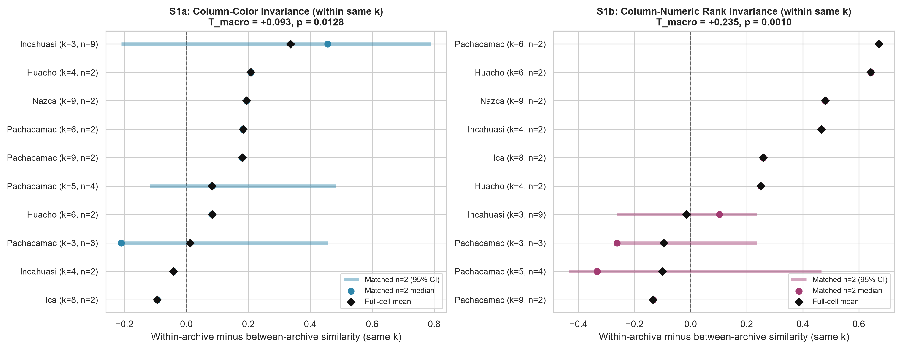
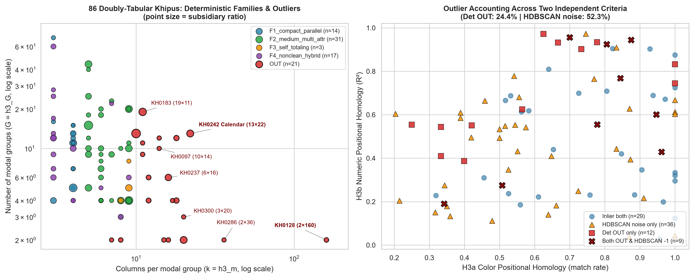
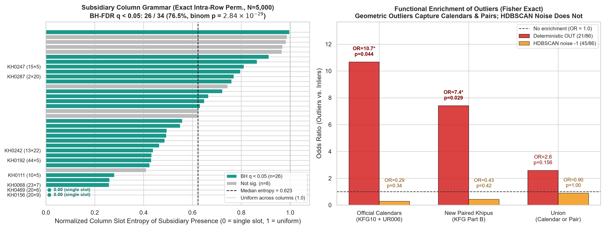
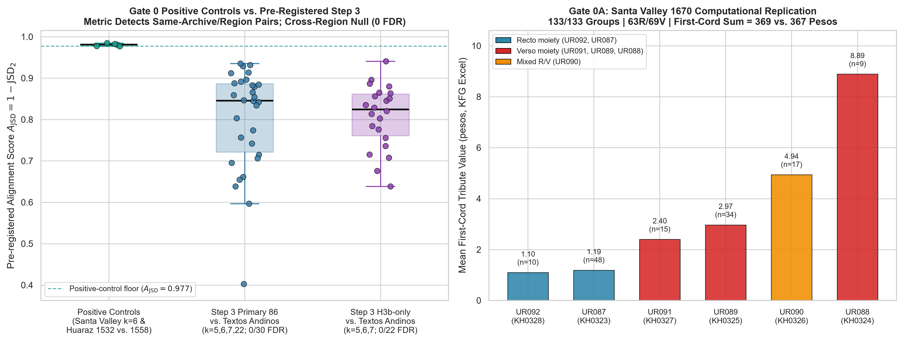
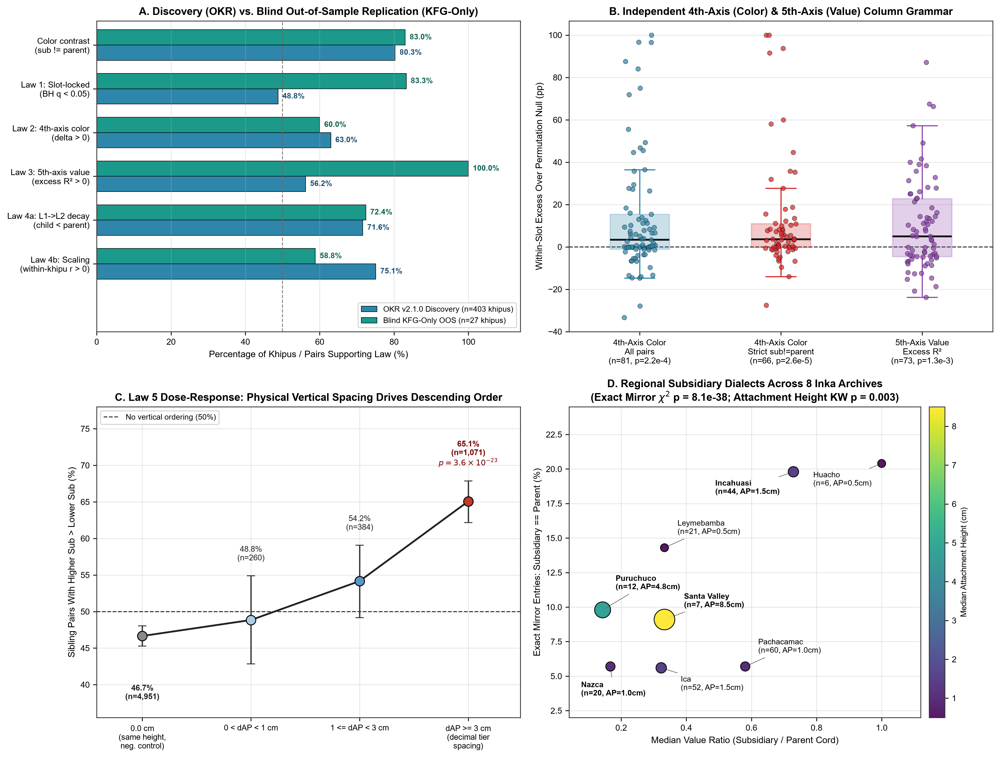
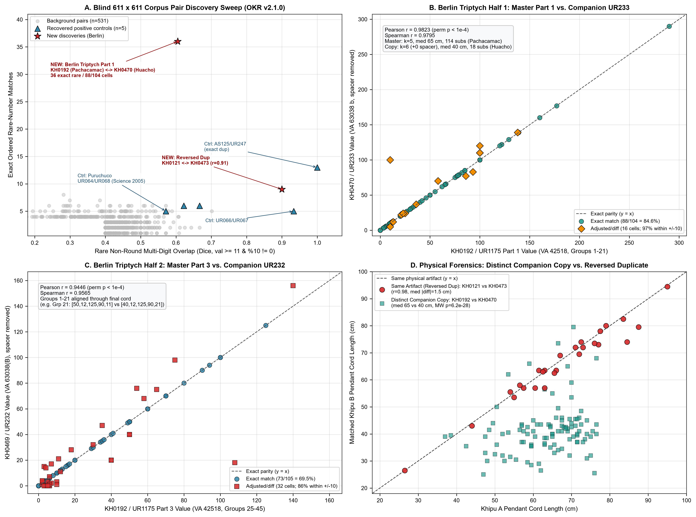

# Consolidated Results (`[PREREG]` vs. `[EXPLORATORY]`)

Every empirical result below is explicitly labeled **`[PREREG]`** (internally pre-specified in [`PREREGISTRATION.md`](PREREGISTRATION.md); see [`DEVIATIONS.md`](DEVIATIONS.md) for all deviations and the same-day freeze/execution caveat) or **`[EXPLORATORY]`** (post-hoc extensions detailed in [`EXPLORATORY.md`](EXPLORATORY.md)). For permutation tests with `N_PERM` permutations, `p`-values are bounded by `p >= 1 / (N_PERM + 1)`; extreme asymptotic bounds are reserved for parametric/asymptotic tests and accompanied by effect sizes and confidence intervals.

---

## Data Hygiene Note: The KFG `khipu_summary.csv` Subsidiary Bug

In our upstream concordance audit (`Disentangle-Lab/khipu-okr-kfg-concordance`, `n = 611`), KFG's pre-aggregated summary CSV (`khipu_summary.csv`) was found to silently drop **`2,313` subsidiary cords** (`CORD_LEVEL >= 2`) relative to both OKR v2.1.0 (`khipu.db`) and KFG's own individual Excel workbooks (`KFG_DB_Excel/*.xlsx`). **Fix implemented here:** [`src/data_loader.py`](src/data_loader.py) never reads subsidiary counts from `khipu_summary.csv`; instead, it traces every `CORD_LEVEL >= 2` cord directly to its root pendant in `khipu.db` (and parses individual `KFG_DB_Excel/*.xlsx` sheets for cross-repository checks and blind out-of-sample replication).

---

## Phase 1 — Internally Pre-Specified Analyses (`[PREREG]`)

### Step 1 — Inter-Khipu Archive Invariance Controlling for `k` and Sample Size (`[PREREG]`)

Tested across `44` provenienced specimens in `primary_86` (`10` `(site, k)` cells across `6` `k`-strata, `N_PERM = 5,000`, minimum permutation `p = 1/5001 = 0.0002`; full table: [`results/step1_archive_tests.csv`](results/step1_archive_tests.csv)). **Primary metrics** (`S1a` modal color match and `S1b` OKR numeric rank) are listed first, followed by robustness checks:

| Test | Metric & Spec | `T_macro` (within − between) | `p_macro` | Dedup `p` (`n=41`) | `(k, cat)` `p` | LOO no Incahuasi `p` (`n=30`) | LOO no Pachacámac `p` (`n=19`) |
| :--- | :--- | :---: | :---: | :---: | :---: | :---: | :---: |
| **S1a (Color)** | **Modal match (primary)** | **`+0.0934`** | **`0.0128`** | `0.0110` | `0.0028` | `0.0472` | **`0.2853`** |
| **S1a (Color)** | Full-dist JSD (robustness) | `+0.1265` | `0.0034` | `0.0048` | `0.0008` | `0.0086` | `0.0326` |
| **S1b (Numeric)** | **Rank Spearman (OKR primary)** | **`+0.2355`** | **`0.0010`** | `0.0072` | `0.0042` | `0.0040` | `0.0004` |
| **S1b (Numeric)** | Rank Spearman (KFG Excel) | `+0.1613` | `0.0144` | `0.0296` | `0.0126` | — | — |

*Note on primary `S1a` sensitivity:* Modal color match is significant overall (`p_macro = 0.0128`), after deduplication (`p = 0.0110`), within `(k, cataloger)` strata (`p = 0.0028`), and without Incahuasi (`p = 0.0472`), but loses significance when Pachacámac (`4` of `10` cells) is omitted (`T_macro = +0.0403`, `p = 0.2853`) and in the broader `sens_H3a_133` cohort (`p = 0.0834`). By contrast, full-distribution color JSD (`p = 0.0326` without Pachacámac) and primary `S1b` numeric rank (`p = 0.0004` without Pachacámac) remain significant across all leave-one-archive-out checks. Matched `n=2` subsampling distributions are in [`results/step1_matched_subsample.csv`](results/step1_matched_subsample.csv).

### Step 2 — Tabular Taxonomy & Explicit Outlier Dossier (`n = 86`, `[PREREG]`)

Full per-specimen table: [`results/step2_signatures_86.csv`](results/step2_signatures_86.csv). **Mandatory individual outlier dossier for all `21` deterministic outliers (`OUT`) and HDBSCAN noise specimens:** [`results/step2_outliers_dossier.csv`](results/step2_outliers_dossier.csv).

| Family (`[PREREG]`) | Count (`n = 86`) | Share | Notes |
| :--- | :---: | :---: | :--- |
| `F2_medium_multi_attr` | `31` | `36.0%` | `k ∈ [5, 9]`, `G >= 3`, clean decimal |
| **`OUT` (Deterministic outliers)** | **`21`** | **`24.4%`** | Extreme arities (`k = 10..160`), `G = 2` minimal tables — see [`step2_outliers_dossier.csv`](results/step2_outliers_dossier.csv) |
| `F4_nonclean_hybrid` | `17` | `19.8%` | `clean_dec_frac < 0.90` |
| `F1_compact_parallel` | `14` | `16.3%` | `k ∈ {3, 4}`, `G >= 3`, clean decimal |
| `F3_self_totaling` | `3` | `3.5%` | Significant `H5c` slot sums or strict `×100` totals |
| *HDBSCAN unforced noise (`-1`)* | *`45`* | *`52.3%`* | 4 clusters + 45 unforced noise points (overlap with `OUT`: `9/86`) |

### Gate 0 (Proxy Positive Controls) & Step 3 (Colonial Alignment Null + Power Analysis)

*(See [`DEVIATIONS.md`](DEVIATIONS.md) for the major Gate 0 deviation, colonial corpus changes, non-independence of the three Huaraz schemas, and `k=6` Null 1 FDR floor.)*

- **Gate 0A (`[PREREG]`-modified replication of Medrano & Urton 2018):** Exact `133 / 133` six-cord groups, `63R / 69V` (`+1 U`) vs. `63R / 70V`, first-cord sum `369` (KFG) / `373` (OKR) vs. `367` pesos in the 1670 *revisita*, `31` (`15` singletons) vs. `32` (`17` singletons) colors ([`results/gate0a_santa_valley_replication.csv`](results/gate0a_santa_valley_replication.csv)).
- **Gate 0B (`[PREREG]`-modified proxy positive controls):** Same-archive Santa Valley `k=6` pairs achieve **`A_JSD = 0.977–0.985` (`fwd`, Null 2 `p = 0.0002`, `N_PERM = 5,000`)**; text-to-text Huaraz 1532 (`m_60`) ↔ Huaraz 1558 (`m_63`, `k=7`) achieves **`A_JSD = 0.9774` (`fwd`, `A_rank = 0.7857`, exact Null 1 `p = 0.00952`)** ([`results/gate0b_santa_valley_calibration.csv`](results/gate0b_santa_valley_calibration.csv)).
- **Step 3 Primary (`k_K == k_D`, `[PREREG]`):** **`0 / 30`** in `primary_86` and **`0 / 22`** in `sens_H3b_only` pass BH-FDR `q < 0.05` ([`results/step3_alignment_pairs.csv`](results/step3_alignment_pairs.csv)).
- **Step 3 Secondary (`|k_K − k_D| == 1`, `[PREREG]` fulfilled in P0):** **`0 / 70`** in `primary_86` (`min q = 0.0875`); **`1 / 59`** in `sens_H3b_only` (`KH0278` Lima `k=4` vs. `chucuito_1567_moiety_k5`, `A_JSD = 0.9892`, Null 2 `q = 0.0354`, fails Null 1 `p = 0.100`, mismatched provenance; [`results/step3_secondary_k_pm1.csv`](results/step3_secondary_k_pm1.csv)).
- **Step 3 Power Analysis (`[EXPLORATORY]` P0 audit, [`results/step3_power_analysis.csv`](results/step3_power_analysis.csv)):** Under the actual **BH-FDR (`m = 30`)** decision threshold at `σ = 0.20`, power is **`70.8%` (`k = 5`)**, **`59.2%` (`k = 7`)**, and **`0.0%` (`k = 6`)**, compared with `96.7–100%` nominal `p_eval < 0.05` power:

| `k` | `σ = 0.0` (mean `A_JSD` / `p<0.05` / FDR30) | `σ = 0.10` | `σ = 0.20` | `σ = 0.30` | `σ = 0.50` | `σ = 1.00` | Min Null 1 `p` |
| :---: | :---: | :---: | :---: | :---: | :---: | :---: | :---: |
| **`5`** | `1.000` / `100%` / `100%` | `0.999` / `100%` / `84.2%` | `0.996` / `96.7%` / **`70.8%`** | `0.990` / `85.0%` / `59.2%` | `0.972` / `71.7%` / `57.5%` | `0.909` / `56.7%` / `45.0%` | `2/120 = 0.0167` *(Null 2 used)* |
| **`6`** | `1.000` / `100%` / **`0.0%*`** | `0.999` / `100%` / **`0.0%*`** | `0.995` / `100%` / **`0.0%*`** | `0.988` / `97.5%` / `0.0%*` | `0.971` / `80.8%` / `0.0%*` | `0.911` / `42.5%` / `0.0%*` | `2/720 = 0.00278*` |
| **`7`** | `1.000` / `100%` / `100%` | `0.999` / `100%` / `88.3%` | `0.995` / `99.2%` / **`59.2%`** | `0.991` / `92.5%` / `48.3%` | `0.972` / `84.2%` / `29.2%` | `0.901` / `50.0%` / `10.0%` | `2/5040 = 0.00040` |

*\*For `k = 6`, Null 1's discreteness floor (`2/720 = 0.00278`) prevents a single isolated match from crossing BH-FDR `q < 0.05` across `m = 30` tests, though nominal `p_eval < 0.05` power is `97.5–100%` for `σ ≤ 0.30`.*

---

## Phase 2 — Exploratory Extensions (`[EXPLORATORY]`)

Full deduplicated statistics, 95% confidence intervals, khipu-level Holm/BH corrections across all five candidate regularities, and descriptive Berlin pair-sweep forensics are documented in [`EXPLORATORY.md`](EXPLORATORY.md):

- **Phase 2A (`[EXPLORATORY]`):** Five candidate hierarchical subsidiary regularities (`R1–R5`) all survive specimen deduplication and Holm–Bonferroni correction across the five reported khipu-level tests (`p_holm ≤ 2.12e-03`, with `R5` evaluated at the khipu level: `84/137` khipus, Wilcoxon `p = 1.06e-03`; note that post-hoc Holm over 5 selected tests underestimates broader exploratory multiplicity and `R3`'s median bootstrap 95% CI `-2.02` to `+11.67 pp` includes 0), replicate in direction and magnitude on `36` strictly disjoint KFG-only workbooks (`27` with subsidiaries, `605` cords), and display archive-specific variation across `8` sites ([`results/phase2a_dedup_effect_sizes.csv`](results/phase2a_dedup_effect_sizes.csv), [`results/phase2a_candidate_regularities_summary.csv`](results/phase2a_candidate_regularities_summary.csv)).

- **Phase 2C (`[EXPLORATORY]`):** Descriptive `611 × 611` rare-number sweep (`~186k` pairs; exact pre-filter `n_rare_dist ≥ 5` and [`rare_dice ≥ 0.25` or `n_rare_dist ≥ 10`] retaining `538` candidate pairs in [`results/phase2c_corpus_pair_sweep.csv`](results/phase2c_corpus_pair_sweep.csv)) recovers known positive controls and ranks two putative Berlin links at **`#1 / 538`** (`KH0192` Part 1 ↔ `KH0470`: `88/104` exact, `r = 0.982`, post-selection permutation `p ≤ 1e-4`; Part 3 ↔ `KH0469`: `73/105` exact, `r = 0.945`, post-selection `p ≤ 1e-4` found via targeted lot inspection; Part 2 absent from `VA 63038`) and **`#3 / 538`** (putative reversed physical duplicate `KH0121` ↔ `KH0473`: `27/29` values, cord-length `r = 0.977`, median `|Δlen| = 1.5 cm`), pending museum verification ([`results/phase2c_discoveries_summary.csv`](results/phase2c_discoveries_summary.csv)). Sweep results are presented descriptively without sweep-wide multiple-testing correction; a full-sweep empirical null is scheduled for the companion OKR↔KFG / `v1.1.0` study.

---

## Step 4 — Limitations & Future Work (Non-Decimal / Narrative Regime)

Specimens with systematic non-decimal irregularities (`clean_dec_frac < 1.0`) and S/Z spatial-block calendar candidates are explicitly excluded from semantic decoding claims. Without ground-truth transcriptions for non-decimal or narrative khipus, semantic attribution in that regime remains an untested hypothesis.
